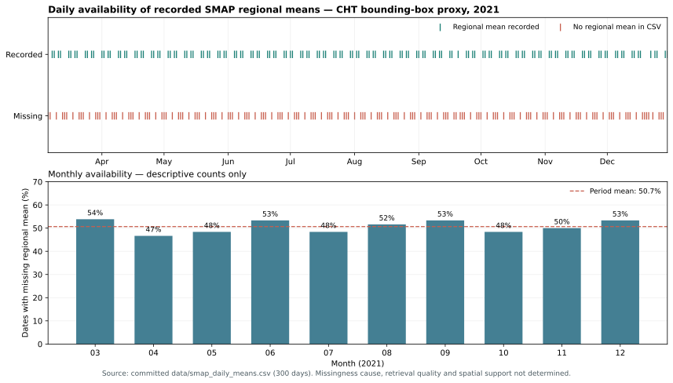

# Soil Moisture Gap-Filling — Chittagong Hill Tracts, Bangladesh
### A feasibility study using SMAP L3 + Sentinel-1 SAR + XGBoost

> **Research status (October 2026): exploratory and not externally validated.**
> The 300-date availability series is reproducible, but the original model's
> reported accuracy is not independently reproduced here. Its test set was
> used for early stopping, and the predictor export is not in the repository.
> See [scientific audit](docs/RESEARCH_AUDIT.md) and
> [reproducibility protocol](docs/REPRODUCIBILITY.md) before quoting the figures.


*Availability figure regenerated exclusively from the committed daily CSV; missingness cause is not inferred.*

## Overview
NASA's SMAP mission measures surface soil moisture globally. In this
project's **2021 regional daily-mean CSV**, **152 of 300 calendar days
(50.7%) are missing**. The experiment was inspired by Zhang et al. (2025),
who compared ERA5-based gap-filling and bias-correction methods globally,
but applies a different Sentinel-1 / meteorology / XGBoost workflow to a
bounding rectangle around the Chittagong Hill Tracts (CHT). It explores
whether radar adds useful signal in a challenging forested region.
It does **not yet demonstrate** a specific cause of missing observations,
independent soil-moisture accuracy, or a canopy attenuation mechanism.

## Key Findings

### 1. Availability of the exported regional daily mean (verified)
- 152 of 300 dates (50.7%) have a blank SMAP value in the committed CSV.
- The recorded monthly missing fraction is comparatively stable (about 47–54%).
- **Cause unknown:** RFI, observation frequency, quality masks and regional
  observation support have not been separately quantified.

### 2. Reported model-feature attribution (provisional)
- The notebook reports about 40% model importance for day of year,
  31% for antecedent precipitation and 15% combined for SAR predictors.
- Feature importances and SHAP values do not measure causal contribution
  or establish independently useful SAR information. The clean evaluation
  script now provides a no-SAR versus SAR model ablation for re-testing.
- Forest attenuation and topographic effects remain plausible hypotheses,
  not conclusions demonstrated by these data.

### 3. Historical model performance (revalidation needed)
- Reported RMSE **0.0445 m³/m³** and R² **0.036**, against held-out SMAP
  labels—not independent field measurements.
- The model used its test set for early stopping, so the reported test
  statistics cannot be considered strictly independent. Re-run with a
  separate validation block and simple baselines before comparing skill.
- No operational SMAP or ESA soil-moisture accuracy threshold is claimed.

## What This Means for Forest Ecohydrology
The work motivates careful study of forest soil-moisture **observability**:
how frequently SMAP retrievals are available, how strongly meteorological
baselines perform, and when Sentinel-1 carries incremental information.
Next comparisons could include SMAP L4 (a model-assimilation product,
not independent ground truth), independent field probes and new L-band SAR.
NISAR launched in 2025 and NASA released provisional L-band data in 2026;
its applicability to CHT remains to be evaluated.

## Study Area
**CHT bounding-box proxy, Bangladesh** (91.6°E–92.6°E, 21.5°N–23.8°N).
This is not yet a vetted administrative CHT or forest-only boundary.
**Study period:** March-December 2021

## Data Sources
| Dataset | Source | Resolution | Role |
|---|---|---|---|
| SMAP enhanced L3 soil moisture | NASA/NSIDC | 9 km grid (coarser radiometer footprint), daily composite | Target variable; 2021 requires GEE `/005` |
| Sentinel-1 SAR (VV, VH) | ESA Copernicus | fine-resolution dB backscatter | Radar predictors; historical dB-ratio feature needs correction |
| MODIS NDVI | NASA | 1 km, 16-day (MOD13A2) | Vegetation state; EVI must be separately exported |
| ERA5 precipitation + 7-day lag | ECMWF | 9 km, daily | Moisture forcing |
| SRTM DEM + slope | USGS | 30 m | Terrain |
| Topographic Wetness Index | HydroSHEDS | 15 arc-sec | Drainage patterns |
| Day of year | derived | — | Seasonality |

## Methods
1. All data loaded and preprocessed in Google Earth Engine (Python API)
2. Sentinel-1 filtered to 30-45 degree incidence angle to reduce
   terrain distortion in CHT's steep topography (Navacchi et al., 2023)
3. Legacy notebook contains an attempted 36-km resampling; verify native 9-km grid and footprint alignment on re-export
4. XGBoost trained using multiple pixel samples tied to regional daily-mean SMAP labels; these are **not** independent pixel targets
5. Temporal holdout: train March–August, test September–December, but test labels were reused for early stopping
6. SHAP explainability analysis to diagnose feature contributions
7. Gap-filled predictions aggregated to daily means for time series

## Results
| Metric | Value |
|---|---|
| Gap rate | 50.7% (152/300 days) |
| RMSE (historical, not independently revalidated) | 0.0445 m³/m³ |
| R² (historical, test used for early stopping) | 0.036 |
| Top predictor (reported model importance) | DOY (~40%) |
| SAR importance (not ablation-based skill) | ~15% combined |
| Validation approach | March–August train; September–December nominal test; selection leakage |

### Historical exploratory model figures


*The embedded RFI explanation and ±RMSE "uncertainty" labels in this legacy figure are unverified and should not be quoted.*


*Historical notebook figure; not a valid independent accuracy benchmark.*


## Limitations and Future Work
- Dense vegetation may weaken C-band sensitivity; no controlled physical
  attribution or general L-band accuracy improvement has been demonstrated
- Full Radiometric Terrain Correction (RTC) of Sentinel-1 not applied;
  incidence angle filtering used as pragmatic quality control
- No in-situ soil-moisture observations were used for independent validation
- Per-pixel spatial gap-filling (vs regional daily means) is next step
- SoilGrids clay/sand texture and MODIS LAI are natural feature additions

## References
- Zhang et al. (2025). Global-scale gap filling of satellite soil moisture
  products: Methods and validation. *Journal of Hydrology*, **653**, 132762.
  https://doi.org/10.1016/j.jhydrol.2025.132762
- Mao et al. (2019). Gap filling of high-resolution soil moisture for
  SMAP/Sentinel-1: A two-layer machine learning-based framework.
  *Water Resources Research*, **55**, 6986–7009.
  https://doi.org/10.1029/2019WR024902
- Beale et al. (2025). Low-rank gap filling and downscaling for SMAP soil
  moisture datasets. *Ecohydrology*, **18**, e70024.
  https://doi.org/10.1002/eco.70024
- Al-Yaari et al. (2014). Global-scale evaluation of two satellite-based
  passive microwave soil moisture datasets. Remote Sens. Environ., 149.
- Navacchi et al. (2023). Utilising Sentinel-1's orbital stability for
  efficient pre-processing of RTC gamma nought backscatter. Sensors, 23.
- Zhao et al. (2025). Multifrequency subsurface soil moisture retrieval
  for forest flows. IEEE JSTARS, 18.
- Baghdadi et al. (2017). Calibration of the Water Cloud Model at C-Band.
  Remote Sensing, 9(9), 969.

## Repository Structure
```
cht-soil-moisture-gapfilling/
├── Project_1.ipynb              # Legacy exploratory notebook (not clean execution order)
├── README.md                    # This file
├── docs/                        # Evidence audit, revalidation and literature
├── scripts/                     # Availability audit and honest temporal test
├── tests/                       # Offline methodological guards
├── requirements.txt             # Python dependencies
├── .gitignore                   # Excludes large files
├── data/
│   └── smap_daily_means.csv     # SMAP valid/gap labels (300 dates)
└── results/
    ├── final_result.png         # Main result — time series + gap analysis
    ├── model_performance_final.png  # R2, RMSE, feature importance
    ├── shap_analysis.png        # Historical SHAP explanation
    ├── availability_audit.json  # Verified CSV availability audit
    ├── availability_monthly.csv # Verified monthly availability
    └── availability_verified.svg # Verified availability plot
```

## How to Run
```bash
python scripts/audit_availability.py
python scripts/plot_availability.py
python -m unittest discover -s tests -v
pip install -r requirements.txt
# Needs the separately exported GEE predictor file:
python scripts/evaluate_temporal.py --predictors data/cht_temporal_with_smap.csv
```
To reproduce the full model, first re-export valid 2021 inputs using the
current product-version guidance in [REPRODUCIBILITY.md](docs/REPRODUCIBILITY.md).
The original notebooks are retained as provenance and require GEE access;
their intermediate files are not committed. **Do not run notebook cell 49
without checking its destructive file-cleanup list.**

---
*Exploratory independent research in forest ecohydrology and machine
learning, inspired by—but not a direct replication of—Zhang et al. (2025).*
