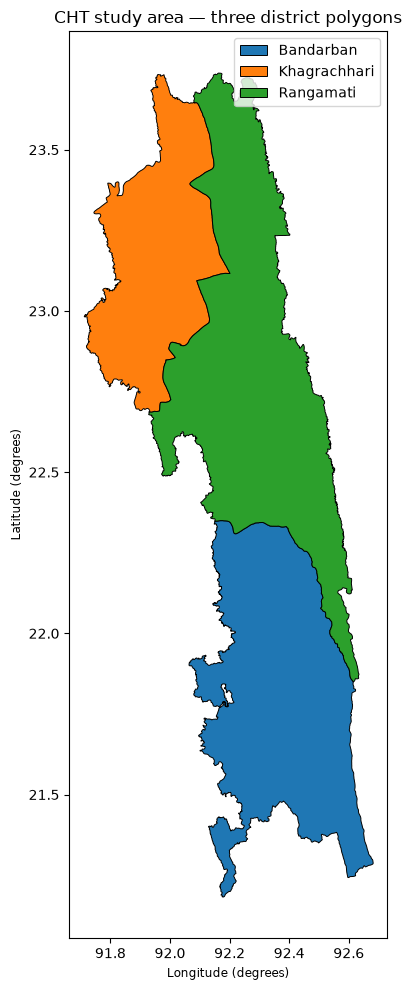
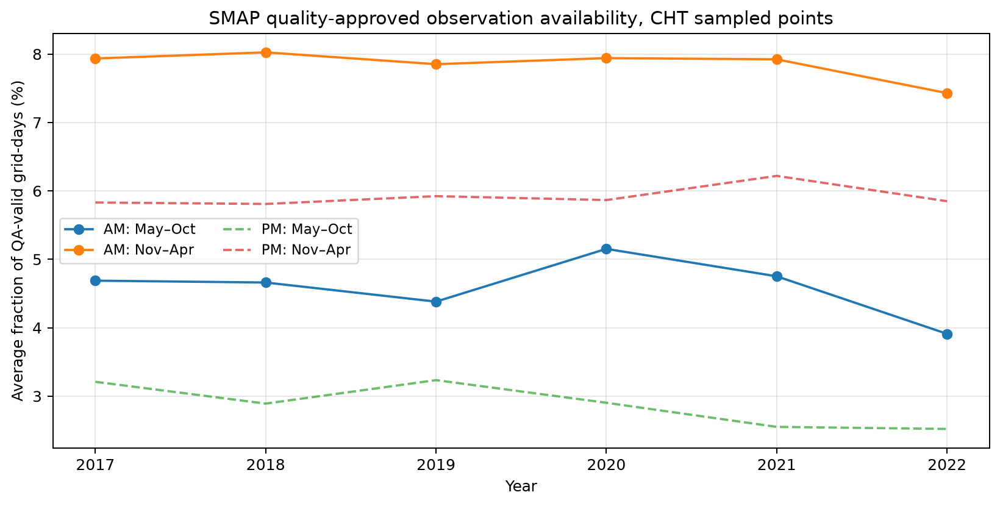
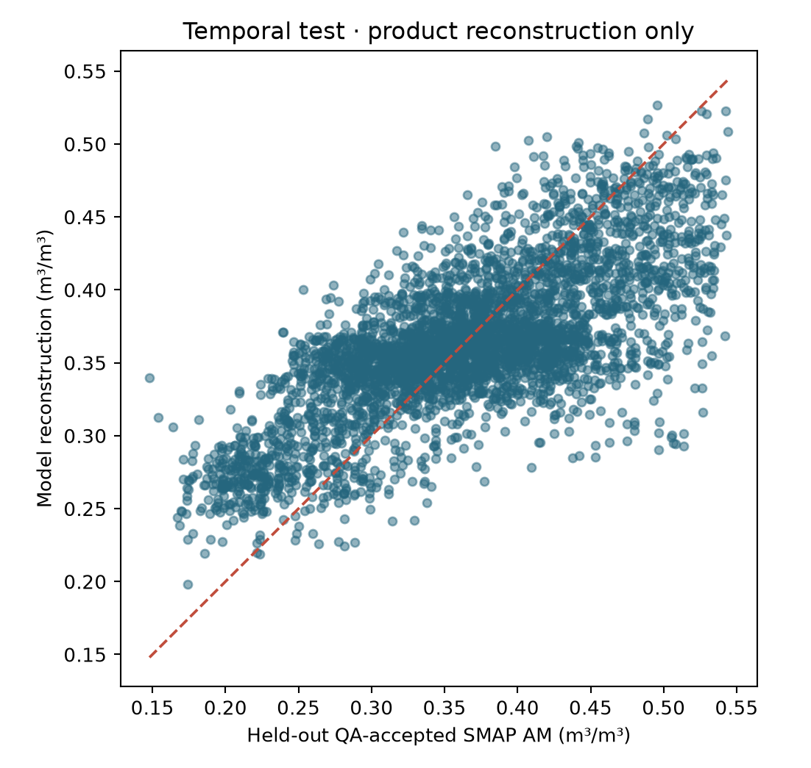
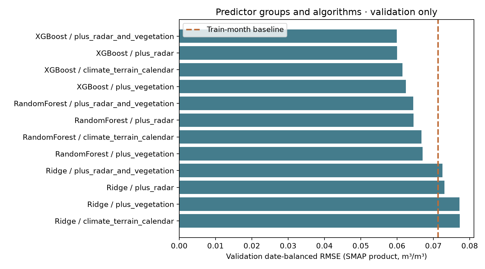
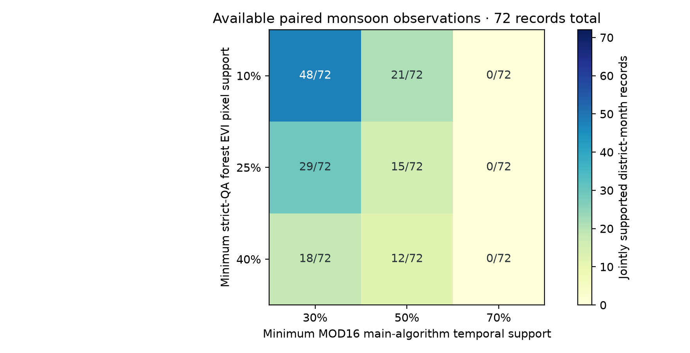

# Chittagong Hill Tracts | Satellite Soil-Moisture Gap Filling & Forest Ecohydrology

**An open, notebook-based geospatial research study for Bandarban, Khagrachhari and Rangamati, Bangladesh.**

**Study area:** Chittagong Hill Tracts (three districts)  
**Research themes:** Forest ecohydrology · satellite observations · machine learning · data quality  
**Time periods:** 2017–2022 hydroclimate and vegetation context; 2019–2022 SMAP reconstruction  
**Tools:** Google Earth Engine, Python, Jupyter, GeoPandas, scikit-learn and XGBoost  
**Status:** Completed *satellite-product reconstruction* experiment; **not independently ground validated**.

> **The central finding:** On held-out 2022 records that passed SMAP's quality screen, the selected XGBoost model reconstructed the **SMAP satellite product** more closely than simple baselines. That does **not** demonstrate the accuracy of actual soil moisture on the ground, and the model has not been validated for cells where acceptable SMAP retrievals are absent.

This repository brings together the [original soil-moisture gap-filling prototype](legacy/README.md) and the corrected, expanded **Forest Ecohydrology and Machine Learning** study. It is organized in a results-first style inspired by the [Hakaluki Haor research repository](https://github.com/Bipul-roy-AI/Hakaluki-Haor-Wetland-Methane-Research).

## 1. What this research set out to investigate

The Chittagong Hill Tracts combine complex terrain, forest landscapes and strongly seasonal rainfall. Satellites provide useful regional observations, but measurement availability and quality differ by product, place and season.

The study asks:

1. **Where and when are usable SMAP soil-moisture observations available?** How does quality filtering limit the training sample?
2. **Can a model reconstruct held-out, quality-accepted SMAP observations?** Does it outperform simple averages, and how do radar and vegetation predictors affect performance?
3. **How does the monsoon shape the forest ecohydrology context?** What do rainfall, vegetation-index and modeled evapotranspiration records show—and where are they too incomplete for firm conclusions?
4. **What remains uncertain without field measurements?** Which follow-up studies would turn a satellite-product exercise into a stronger ecohydrological assessment?

### Study area

*Figure 1. The three district polygons used in the local boundary-check notebook. The original three-feature shapefile is deliberately not redistributed because its license and provenance have not yet been confirmed. This is a study-area illustration, not a surveyed boundary or legal map.*

## 2. Important results, in plain language

### Result A — Very few sampled SMAP records passed the quality screen

The 2019–2022 extraction evaluated **248,400 sampled posting-date records**. Only **17,653 (7.11%)** met the declared quality-acceptance rules. Accepted records came from **39 grid postings** across **663 distinct dates**. These are sampled records, **not** 248,400 independent physical measurements or a percentage of the whole land area.

| District | Sampled posting-date records | QA-accepted | Accepted share |
|---|---:|---:|---:|
| Bandarban | 86,940 | 4,948 | 5.69% |
| Khagrachhari | 56,580 | 10,988 | 19.42% |
| Rangamati | 104,880 | 1,717 | 1.64% |
| **Total** | **248,400** | **17,653** | **7.11%** |

**Meaning:** A model built only from acceptable satellite retrievals learns from an uneven subset of the landscape and seasons. Reconstructing the *missing* parts of this product is consequently much harder to validate than fitting observations that were already acceptable.

*Figure 2. Availability varies across the study period and seasons. Treat a missing satellite observation as a missing observation, not proof that soil is dry or wet. Source: [SMAP feasibility table](outputs/tables/02C_district_annual_availability.csv) and [training-data manifest](outputs/tables/07_training_data_manifest.json).*

### Result B — The corrected model beat simple baselines on a held-out year

The evaluation used a chronological split: **2019–2020 for training**, **2021 for validation/model selection**, and **2022 for final testing**. The selected model was **XGBoost with climate/terrain/calendar, Sentinel-1 radar and vegetation predictors**. Its 2022 test covered **4,042 accepted rows**, **143 dates**, and **39 grid postings**.

| 2022 test model | RMSE (m³/m³) ↓ | MAE (m³/m³) ↓ | R² ↑ |
|---|---:|---:|---:|
| **Selected XGBoost** | **0.0555** | **0.0444** | **0.544** |
| Calendar-month average baseline | 0.0701 | 0.0555 | 0.272 |
| Overall training mean baseline | 0.0821 | 0.0667 | ~0.000 |

**Meaning:** The selected model had approximately **20.8% lower RMSE than the calendar-month baseline** and **32.4% lower RMSE than the overall-mean baseline**, on the *same held-out, quality-accepted SMAP records*. Lower RMSE means closer agreement with SMAP; **it does not mean 0.0555 m³/m³ field accuracy**. Scores use **equal total weight per observation date**.

*Figure 3. Reconstructed versus observed SMAP product values in the held-out year. The reference is the quality-accepted **satellite retrieval**, not a soil probe. Source: [2022 test metrics](outputs/tables/08_temporal_test_metrics.csv) and [test predictions](outputs/tables/08_predictions_temporal_test.csv).*

### Result C — Radar helped; vegetation's additional gain was small in validation

The model comparison included Ridge regression, Random Forest, XGBoost and two simple baselines, with and without radar/vegetation predictor groups. On the **2021 validation** split:

| XGBoost predictor group | Date-balanced RMSE (m³/m³) ↓ |
|---|---:|
| Climate, terrain and calendar | 0.06147 |
| + Radar | 0.05996 |
| + Vegetation | 0.06240 |
| + Radar **and** vegetation | **0.05990** |

**Meaning:** Including radar improved performance relative to the core predictors in this experiment. Adding vegetation to the radar model produced only a **very small** further change (about 0.00006 m³/m³ RMSE). These are **predictive comparisons, not causal proof** that radar or vegetation controls soil moisture.

*Figure 4. Model selection was performed on 2021, before the 2022 test. Full values: [validation leaderboard](outputs/tables/08_validation_leaderboard.csv).*

An additional **held-out-grid and future-date** check reported XGBoost RMSE **0.0621 m³/m³**, MAE **0.0493 m³/m³**, and R² **0.392** on **8 held-out grid postings** and **903 observations**. This is useful evidence of greater spatial-transfer difficulty, but its sample and experiment differ from the temporal test; **the two scores should not be interpreted as a controlled head-to-head comparison**. Grid postings are not independent SMAP sensor footprints. [Spatial metrics](outputs/tables/08_spatial_test_metrics.csv).

### Result D — Monsoon rainfall is strong, but optical/ET observation support is weak

The 2017–2022 gridded rainfall context shows a pronounced June–September monsoon. Alongside it, the study assessed whether forest EVI (vegetation greenness) and **modeled** MOD16 evapotranspiration (ET) had enough quality/algorithm support for interpretation.

| District | Mean annual CHIRPS v3 rainfall, 2017–2022 | Share falling June–September | Monsoon district-months passing both EVI/ET support screens |
|---|---:|---:|---:|
| Bandarban | 3,409 mm | 78.7% | 5 of 24 |
| Khagrachhari | 2,859 mm | 71.4% | 4 of 24 |
| Rangamati | 3,193 mm | 74.3% | 6 of 24 |
| **All districts** | — | — | **15 of 72** |

**Meaning:** Monsoon rainfall is prominent in these gridded estimates, but only **15 of 72** June–September district-months met *both* exploratory quality-support screens. Missing/cloud-limited EVI or weak ET-algorithm support must not be misread as a vegetation or ET decline. CHIRPS is also a gridded precipitation product, not a local gauge validation.

*Figure 5. Rainfall and paired vegetation/ET observation support are different quantities plotted for context, not evidence of a causal relationship. Data: [district summaries](outputs/tables/05_district_descriptive_summary.csv), [joint-screen counts](outputs/tables/06_monthly_joint_support.csv).*

### Result E — The EVI/ET interpretation changes when quality thresholds change

Across **216 district-months**, **81** failed the initial exploratory *joint* EVI/ET support screen. During the monsoon, alternative support-threshold pairs admitted anywhere from **0 to 48 of the same 72 district-months**.

*Figure 6. The evidence base changes substantially with screening rules. The figure shows **observation support**, not changes in forest health, drought or actual ET. Source: [quality-threshold sensitivity table](outputs/tables/06_threshold_sensitivity.csv).*

## 3. Methods and satellite data

This was a **remote-sensing and machine-learning feasibility/reconstruction study**, not an in-situ hydrological measurement campaign.

| Research component | Source and use | Key caution |
|---|---|---|
| Surface soil-moisture target | [NASA SMAP enhanced Level-3 v005](https://developers.google.com/earth-engine/datasets/catalog/NASA_SMAP_SPL3SMP_E_005), AM retrieval, 2019–2022 | Quality flags filter retrievals; 9-km **grid posting** is not an independently measured 9-km footprint |
| Radar covariates | [Sentinel-1 GRD](https://developers.google.com/earth-engine/datasets/catalog/COPERNICUS_S1_GRD) | Incidence geometry, vegetation and terrain affect backscatter; radar is a predictor, not ground truth |
| Rainfall context | [CHIRPS version 3 daily](https://developers.google.com/earth-engine/datasets/catalog/UCSB-CHC_CHIRPS_V3_DAILY_RNL), 2017–2022 | Gridded rainfall, not locally gauge-validated here |
| Vegetation context | [MOD13Q1 EVI](https://developers.google.com/earth-engine/datasets/catalog/MODIS_061_MOD13Q1) | Quality/cloud screening sharply reduces usable monsoon support |
| Evapotranspiration context | [MOD16A2GF](https://developers.google.com/earth-engine/datasets/catalog/MODIS_061_MOD16A2GF) | Model-derived ET and algorithm-support diagnostics, not observed flux |
| Terrain and districts | Local three-district polygon + terrain predictors | Boundary source/license need independent confirmation before release |

The workflow: **validate boundaries → inventory data and QA → export 2019–2022 SMAP/predictors → assess gaps → compare baselines/ML using untouched temporal test → examine spatial generalization → integrate quality-aware forest ecohydrology context.** Model selection used validation data; the final 2022 target was held out. See [methods and reproduction guide](docs/METHODS_AND_REPRODUCIBILITY.md).

## 4. Limitations — and why they matter

| Limitation | What it prevents us from claiming |
|---|---|
| **No in-situ soil-moisture measurements** | We cannot say how accurate reconstructed values are against physical soil moisture in the field. |
| **Only 7.11% of sampled posting-dates QA-accepted** | Evaluation may not transfer to missing, rejected, inaccessible or unusual conditions. |
| **Grid postings share broader measurement support** | Posting-level row counts must not be treated as independent footprints. |
| **Temporal correlation and only one held-out year** | Future years and truly independent locations need further testing. |
| **Cloud-sensitive EVI and modeled ET** | No defensible claim about absolute forest transpiration or water balance. |
| **No local rain gauges, flux towers or field ecology checks** | Regional product associations cannot establish physical causes. |
| **Boundary provenance unverified** | The boundary is kept local; mapped administrative areas should not be considered authoritative. |
| **Original prototype uses a different experiment** | Its performance graphics cannot be directly compared with the corrected experiment without re-running identical splits/QA. |

**Practical stopping point:** The satellite-only study is complete through its stated held-out product evaluation. Stronger claims about *real soil moisture*, ecosystem water fluxes or a generalizable forest ecohydrology mechanism require **new independent field observations**.

## 5. Future research directions

1. **Field validation:** Establish stratified 0–5 cm soil-moisture sampling stations across forest, slope, elevation, soil and land-cover types; match observation timing to SMAP overpasses.
2. **Footprint-aware reconstruction:** Aggregate predictors to defensible SMAP sensor-support areas instead of assuming every 9-km posted value is an independent measurement.
3. **Harder generalization tests:** Hold out entire geographic zones/years, quantify error by season and topography, and report error separately where reliable target observations are scarce.
4. **Ecohydrological validation:** Combine rain gauges, field vegetation surveys and flux/ET observations; assess monsoon cloud and terrain biases.
5. **Explainability and uncertainty:** Quantify covariate importance, sensitivity to QA thresholds, and calibrated predictive uncertainty *after* establishing independent validation.

For a fuller research agenda, see [limitations and next studies](docs/LIMITATIONS_AND_FUTURE_RESEARCH.md).

## 6. Research materials and reproducibility

The main branch intentionally contains **one current research workflow** and an explicitly labeled original-study archive.

| Location | What is there |
|---|---|
| [`notebooks/`](notebooks/) | Numbered Jupyter notebooks 00–09, including 02B/02C satellite diagnostics |
| [`configs/study_config.json`](configs/study_config.json) | Study area, dates and GEE Cloud Project `axial-paratext-491911-b6` |
| [`outputs/figures/`](outputs/figures/) | Publication-ready maps/plots from the completed notebook outputs |
| [`outputs/tables/`](outputs/tables/) | Audit tables, summary metrics, manifests and held-out predictions |
| [`outputs/reports/09_integrated_research_summary.md`](outputs/reports/09_integrated_research_summary.md) | Generated integrated Notebook 09 summary |
| [`docs/METHODS_AND_REPRODUCIBILITY.md`](docs/METHODS_AND_REPRODUCIBILITY.md) | Step-by-step Windows/Jupyter/GEE run instructions and data requirements |
| [`legacy/`](legacy/) | Earlier original prototype, illustrations and its historical audit; **not the validated corrected experiment** |

**Start here:** Open [Notebook 00](notebooks/00_study_area_and_boundary.ipynb), then [Notebook 01](notebooks/01_gee_connection_check.ipynb). Run the numbered notebooks in sequence (02 → 02B → 02C → 03 → 04 → 05 → 06 → 07 → 08 → 09), following the [run guide](docs/METHODS_AND_REPRODUCIBILITY.md). **Notebook 07 requires exporting data through Google Earth Engine; Notebook 08 requires its locally assembled input table.** Published result tables and figures can be inspected without re-running exports.

The repository does **not** include private Earth Engine credentials, original district shapefile components or the full raw satellite-extraction dataset. The manifest lists source quarterly export filenames and checksums; anyone reproducing the experiment needs their own lawful boundary copy, valid Earth Engine access and exports.

## 7. References and official product documentation

- NASA / NSIDC. *SMAP Level-3 Enhanced Passive Soil Moisture, version 005* ([Earth Engine product record](https://developers.google.com/earth-engine/datasets/catalog/NASA_SMAP_SPL3SMP_E_005); [user guide](https://nsidc.org/sites/default/files/spl3smp_e-v005-userguide.pdf)).
- Copernicus / ESA. *Sentinel-1 GRD* ([Earth Engine data catalog](https://developers.google.com/earth-engine/datasets/catalog/COPERNICUS_S1_GRD)).
- Climate Hazards Center. *CHIRPS Version 3* ([Earth Engine data catalog](https://developers.google.com/earth-engine/datasets/catalog/UCSB-CHC_CHIRPS_V3_DAILY_RNL)); see also *The Climate Hazards Center Infrared Precipitation with Stations, Version 3*, *Scientific Data* (2026), [DOI: 10.1038/s41597-026-07096-4](https://doi.org/10.1038/s41597-026-07096-4).
- NASA MODIS. *MOD13Q1 vegetation indices* ([Earth Engine](https://developers.google.com/earth-engine/datasets/catalog/MODIS_061_MOD13Q1)) and *MOD16A2GF gap-filled modeled evapotranspiration* ([Earth Engine](https://developers.google.com/earth-engine/datasets/catalog/MODIS_061_MOD16A2GF)).
- *Global-scale gap filling of satellite soil moisture products: Methods and validation*. *Journal of Hydrology* **653** (2025), 132762. [DOI: 10.1016/j.jhydrol.2025.132762](https://doi.org/10.1016/j.jhydrol.2025.132762). A methodological reference to the wider gap-filling literature, **not** a source of this repo's measured results.

### Academic integrity statement

This is a **completed computational research project with satellite-product validation**, not a field-validated soil-moisture map or peer-reviewed journal article. All quantitative results above are traceable to the linked output tables and manifests. Reuse should cite the original satellite products and acknowledge the absence of independent ground validation.
