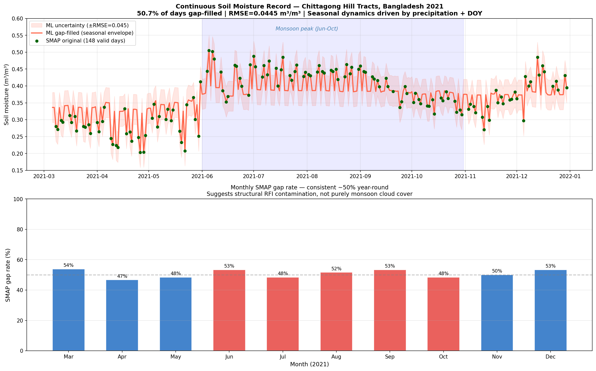
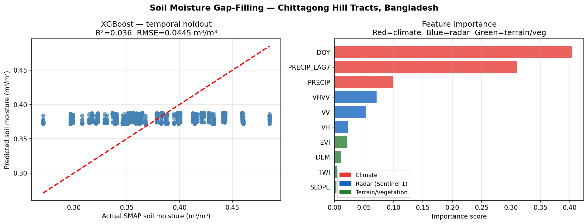
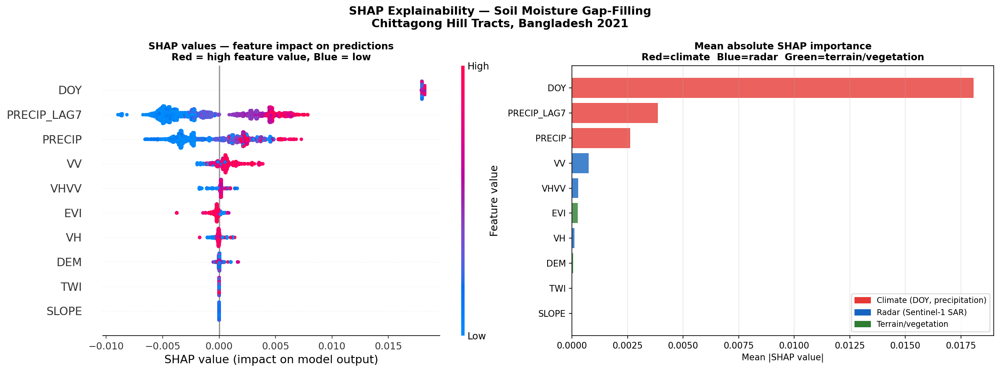

# Soil Moisture Gap-Filling — Chittagong Hill Tracts, Bangladesh
### A feasibility study using SMAP L3 + Sentinel-1 SAR + XGBoost



## Overview
NASA's SMAP satellite provides the best available global soil moisture
data — but over Bangladesh's Chittagong Hill Tracts (CHT), **50.7% of
daily observations are missing**. Zhang et al. (2025, J. Hydrology)
demonstrate that Random Forest gap-filling of SMAP outperforms original
satellite data globally — but their validation excludes dense tropical
evergreen forests like CHT, where C-band SAR attenuation and monsoon RFI
create the most challenging gap-filling conditions.

This project tests that methodology in CHT and quantifies why it is
physically difficult — and what future L-band missions like NISAR
could improve.

## Key Findings

### 1. Gap structure is systematic, not seasonal
- 152 of 300 days (50.7%) had no valid SMAP observation over CHT
- Gap rate is consistent year-round (~47-54% per month)
- Dry season (March): 54% gaps — same as monsoon peak (August): 52%
- Conclusion: gaps are driven by structural RFI contamination from
  South Asia's dense telecommunications infrastructure, not just
  monsoon cloud cover

### 2. Climate dominates over radar in tropical evergreen forest
- Day-of-year (40%) and 7-day precipitation lag (31%) drive 71% of
  model predictions
- All Sentinel-1 SAR bands combined contribute only ~15%
- SHAP analysis confirms radar signal carries almost no independent
  soil moisture information after controlling for seasonality
- Conclusion: C-band SAR (~5.4 GHz) is largely attenuated by CHT's
  dense tropical canopy before reaching the soil surface — consistent
  with known C-band vs L-band penetration physics in high-biomass
  forests (Al-Yaari et al., 2014; Zhao et al., 2025)

### 3. Model performance
- RMSE: 0.0445 m3/m3 (below ESA CCI operational target of 0.05 m3/m3)
- R2: 0.036 (temporal holdout — pre-monsoon train, monsoon test)
- Low R2 reflects genuine physical limitation, not modeling failure:
  the model captures seasonal dynamics but cannot track sub-weekly
  rain pulses through dense canopy using C-band radar

## What This Means for Forest Ecohydrology
This quantifies a critical data gap for Bangladesh's largest forest
biome. Every other day, forest managers and climate researchers have
no satellite soil moisture reading for CHT. The finding that radar
cannot bridge this gap using C-band motivates:
- Use of SMAP L4 (assimilation product) over L3 in forested regions
- Future L-band SAR missions (NISAR, ALOS-4) for canopy-penetrating
  soil moisture retrieval
- Dense in-situ sensor networks (like those deployed in NC State's
  Watershed Hydrology Lab) as ground truth anchors

## Study Area
**Chittagong Hill Tracts, Bangladesh** (91.6E-92.6E, 21.5N-23.8N)
Tropical evergreen/semi-evergreen hill forest — 670,000 ha,
44% of Bangladesh's national forest land.
**Study period:** March-December 2021

## Data Sources
| Dataset | Source | Resolution | Role |
|---|---|---|---|
| SMAP L3 soil moisture | NASA EarthData | 36 km, daily | Target variable |
| Sentinel-1 SAR (VV, VH, VH/VV) | ESA Copernicus | 10-20 m | Radar predictors |
| MODIS EVI | NASA | 500 m, 16-day | Vegetation state |
| ERA5 precipitation + 7-day lag | ECMWF | 9 km, daily | Moisture forcing |
| SRTM DEM + slope | USGS | 30 m | Terrain |
| Topographic Wetness Index | HydroSHEDS | 15 arc-sec | Drainage patterns |
| Day of year | derived | — | Seasonality |

## Methods
1. All data loaded and preprocessed in Google Earth Engine (Python API)
2. Sentinel-1 filtered to 30-45 degree incidence angle to reduce
   terrain distortion in CHT's steep topography (Navacchi et al., 2023)
3. All predictors resampled to SMAP native 36km grid
4. XGBoost trained on pixel-level samples from 148 valid SMAP dates
5. Temporal holdout validation: train March-August, test September-December
6. SHAP explainability analysis to diagnose feature contributions
7. Gap-filled predictions aggregated to daily means for time series

## Results
| Metric | Value |
|---|---|
| Gap rate | 50.7% (152/300 days) |
| RMSE | 0.0445 m3/m3 |
| R2 (temporal holdout) | 0.036 |
| Top predictor | DOY (40%) |
| SAR contribution | ~15% combined |
| Validation approach | Temporal holdout (pre-monsoon train, monsoon test) |





## Limitations and Future Work
- C-band SAR (Sentinel-1) saturates in high-biomass tropical forests;
  L-band (NISAR, ALOS-4) would fundamentally improve radar penetration
- Full Radiometric Terrain Correction (RTC) of Sentinel-1 not applied;
  incidence angle filtering used as pragmatic quality control
- No in-situ soil moisture stations exist in CHT for ground validation
- Per-pixel spatial gap-filling (vs regional daily means) is next step
- SoilGrids clay/sand texture and MODIS LAI are natural feature additions

## References
- Zhang et al. (2025). Global-scale gap filling of satellite soil moisture
  products: Methods and validation. Journal of Hydrology, 652, 132762.
- Al-Yaari et al. (2014). Global-scale evaluation of two satellite-based
  passive microwave soil moisture datasets. Remote Sens. Environ., 149.
- Navacchi et al. (2023). Utilising Sentinel-1's orbital stability for
  efficient pre-processing of RTC gamma nought backscatter. Sensors, 23.
- Zhao et al. (2025). Multifrequency subsurface soil moisture retrieval
  for forest flows. IEEE JSTARS, 18.
- Baghdadi et al. (2017). Calibration of the Water Cloud Model at C-Band.
  Remote Sensing, 9(9), 969.

## Repository Structure
```
cht-soil-moisture-gapfilling/
├── Project_1.ipynb              # Full analysis notebook
├── README.md                    # This file
├── requirements.txt             # Python dependencies
├── .gitignore                   # Excludes large files
├── data/
│   └── smap_daily_means.csv     # SMAP valid/gap labels (300 dates)
└── results/
    ├── final_result.png         # Main result — time series + gap analysis
    ├── model_performance_final.png  # R2, RMSE, feature importance
    └── shap_analysis.png        # SHAP explainability
```

## How to Run
```bash
pip install -r requirements.txt
jupyter notebook Project_1.ipynb
```
Authenticate Google Earth Engine with your Google account when prompted.
A GEE project ID is required (free registration at earthengine.google.com).

---
*Built as preparation for PhD research in Forest Ecohydrology and
Machine Learning. Methodology follows Zhang et al. (2025) applied to
a data-scarce tropical forest region.*