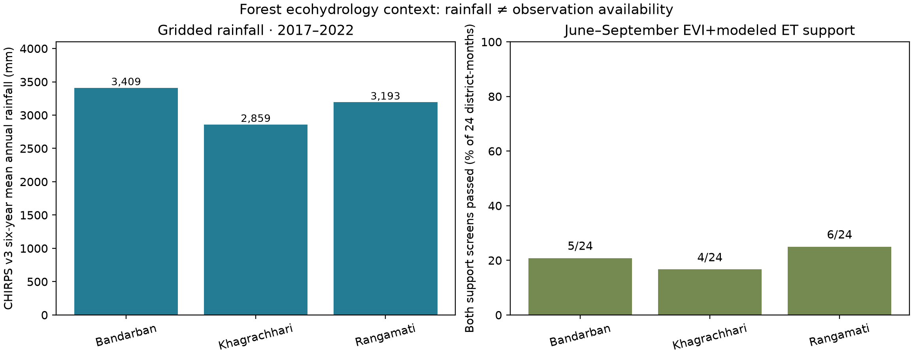

# Chittagong Hill Tracts: SMAP gap-filling and forest ecohydrology

*Research portfolio draft, generated 2026-10-23 UTC; 2017–2022 context; no ground validation.*

## Question and design

Can strictly QA-accepted enhanced SMAP AM soil-moisture retrievals be reconstructed from climate,
radar, vegetation and terrain predictors, and how do rainfall seasonality and forest vegetation/
ET product-support gaps constrain ecohydrological interpretation in Bandarban, Khagrachhari and Rangamati?

## Observed forest ecohydrology context

| District | Mean annual CHIRPS v3 rainfall (mm; 2017–2022) | June–Sept share | Joint high-support EVI+ET months, Jun–Sep |
|---|---:|---:|---:|
| Bandarban | 3,409 | 78.7% | 5/24 |
| Khagrachhari | 2,859 | 71.4% | 4/24 |
| Rangamati | 3,193 | 74.3% | 6/24 |

Across **216 district-months**, **81** lacked
joint support under the declared exploratory 25% strict-QA forest EVI and 50% main-algorithm
modeled-ET support screens. In June–September only **15/72** passed both screens.
Nine alternative support-screen pairs admitted **0/72 to 48/72** June–September
observations: screening sensitivity is a substantive result, not a causal or field-error estimate.

*Figure 1. Mean six-year gridded rainfall alongside percent of June–September district-months passing
both exploratory EVI/ET support screens. Distinct quantities; no causal inference.*

*Figure 2. Count of jointly supported June–September district-months at nine alternative thresholds,
from the same denominator of 72.*

## Corrected soil-moisture ML experiment

**Status: evaluated against held-out QA-accepted SMAP retrievals, not field data.**

| Experiment | RMSE (m³/m³) | MAE (m³/m³) | R² |
|---|---:|---:|---:|
| XGBoost/plus_radar_and_vegetation | 0.05548 | 0.04437 | 0.544 |
| baseline/global_mean | 0.08212 | 0.06670 | -0.000 |
| baseline/calendar_month | 0.07006 | 0.05547 | 0.272 |

Do not interpret these scores as absolute soil-moisture accuracy. Temporal correlation, supported-grid selection and satellite errors remain.

## What this study can and cannot establish

**Supported:** gridded rainfall seasonality; available strict-QA optical forest EVI;
modeled MOD16A2GF forest ET with algorithm-support constraints; SMAP observation feasibility;
and, if independently completed, ability to reconstruct some held-out **SMAP product observations**.

**Not supported:** in-situ volumetric soil moisture, local absolute ET accuracy, forest water
balance, causal rainfall–forest moisture response, extrapolation to SMAP cells without QA
observations, or the claim that enhanced SMAP's grid posting equals footprint resolution.

## Future research

1. Quantify QA retrieval availability by land-cover, slope, season and location; pre-register
   inclusion rules and compare with Sentinel-1/optical observation support.
2. Replace center-pixel predictors with scientifically justified SMAP-footprint support and
   test spatially blocked models where the observed sample permits.
3. Collect stratified in-situ 0–5 cm soil-moisture and soil-texture/canopy/topography records;
   coordinate satellite overpass times to independently assess satellite and model bias.
4. Add rain-gauge checks, measured flux/ET references and explicit monsoon cloud sensitivity
   to support stronger ecohydrological claims.
5. Test multiyear and out-of-domain generalization, uncertainties, forest disturbance and
   lagged precipitation mechanisms **only after the QA and validation foundations are sound**.

## Sources and reproducibility

- SMAP enhanced `/005`: https://developers.google.com/earth-engine/datasets/catalog/NASA_SMAP_SPL3SMP_E_005
- Sentinel-1 GRD dB units: https://developers.google.com/earth-engine/datasets/catalog/COPERNICUS_S1_GRD
- CHIRPS v3: https://developers.google.com/earth-engine/datasets/catalog/UCSB-CHC_CHIRPS_V3_DAILY_RNL
- MOD13Q1 EVI: https://developers.google.com/earth-engine/datasets/catalog/MODIS_061_MOD13Q1
- MOD16A2GF ET: https://developers.google.com/earth-engine/datasets/catalog/MODIS_061_MOD16A2GF
- Notebooks 04–06 generate context; 07 makes QA-checked SMAP table; 08 independently evaluates
  SMAP-product reconstruction if sufficient observations exist; this Notebook 09 integrates evidence.
